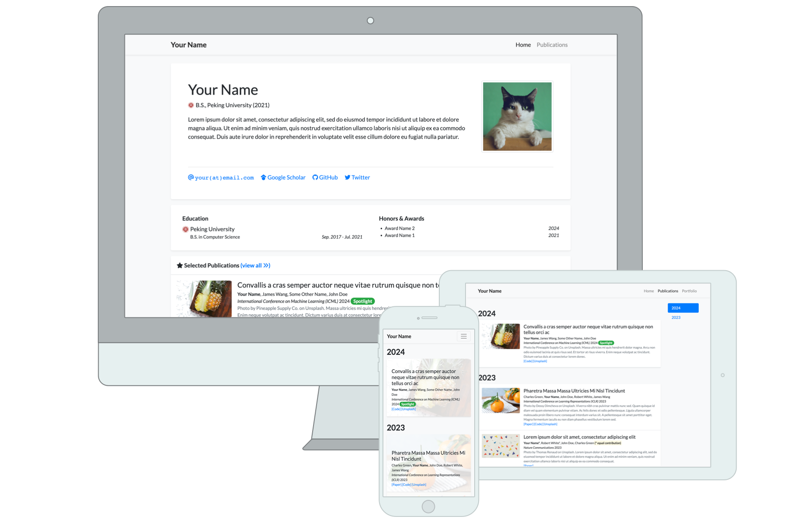

# academic-homepage
<!-- 


[](https://github.com/luost26/academic-homepage/actions/workflows/pages/pages-build-deployment)
[](https://validator.nu/?doc=https%3A%2F%2Fluost26.github.io%2Facademic-homepage)
[](https://hits.sh/github.com/luost26/academic-homepage/)
[](https://github.com/luost26/academic-homepage)
[](https://github.com/luost26/academic-homepage/forks)
[](https://hits.seeyoufarm.com) -->

A personal academic website hosted via Jekyll. Click [here](https://luost.me/academic-homepage/) to see the template.

### Running Locally (Debug & Preview)

Run the following command in the root directory of the repository:

   ```bash
   jekyll serve
   ```
<!-- 
### Deploying to GitHub Pages

2. Go to the repository settings and enable GitHub Pages. Detailed instructions can be found [here](https://docs.github.com/en/pages/getting-started-with-github-pages/creating-a-github-pages-site#creating-your-site).

3. Navigate to your created website, and follow the instructions displayed on the homepage (if any) to finalize the setup.
 -->
